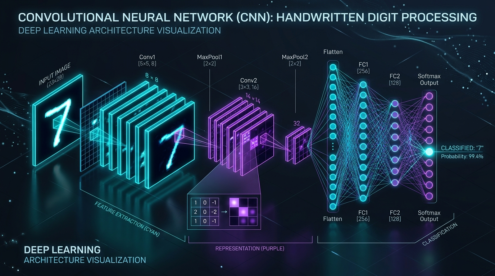

# 🧠 PyTorch Convolutional Neural Network (CNN) from Scratch

[](https://pytorch.org/)
[](https://www.python.org/)
[](#-results--evaluation)
[](https://developer.nvidia.com/cuda-zone)

An end-to-end implementation of a Convolutional Neural Network (CNN) built from the ground up using **PyTorch** to classify handwritten digits from the **MNIST** dataset. This project demonstrates foundational computer vision concepts including 2D convolution filters, spatial downsampling via max pooling, feature flattening, and dense classification layers with dropout regularization.

---

## 🖼️ Architecture Overview



---

## 📌 Key Highlights

- **99.01% Test Accuracy** achieved on the un-seen MNIST test set (10,000 images).
- **Peak Validation Accuracy of 99.85%** during training.
- **Deep Feature Hierarchy:** 2 convolutional stages with $5 \times 5$ kernels extracting low-level edges up to complex digit strokes.
- **Regularization:** Integrated Dropout ($p = 0.5$) preventing co-adaptation and overfitting on dense representations.
- **GPU Accelerated:** Optimized training loop taking full advantage of CUDA when available.

---

## 🏗️ Model Architecture

The model is constructed sequentially (`nn.Sequential`) with two feature extraction blocks followed by a fully-connected classifier:

```
Input: [Batch, 1, 28, 28]
  │
  ├── [Conv1]   Conv2d(1 -> 32, kernel=5, pad=2) + ReLU  ──> [Batch, 32, 28, 28]
  ├── [Pool1]   MaxPool2d(kernel=2, stride=2)             ──> [Batch, 32, 14, 14]
  │
  ├── [Conv2]   Conv2d(32 -> 64, kernel=5, pad=2) + ReLU ──> [Batch, 64, 14, 14]
  ├── [Pool2]   MaxPool2d(kernel=2, stride=2)             ──> [Batch, 64, 7, 7]
  │
  ├── [Flatten] Flatten()                                 ──> [Batch, 3136]
  │
  ├── [FC1]     Linear(3136 -> 1024) + ReLU               ──> [Batch, 1024]
  ├── [Dropout] Dropout(p=0.5)                            ──> [Batch, 1024]
  │
  └── [FC2]     Linear(1024 -> 10) (Logits)               ──> [Batch, 10]
```

### Detailed Layer Specification

| Stage | Layer Type | Parameters / Kernel | Output Shape | Activation |
| :--- | :--- | :--- | :--- | :--- |
| **Input** | Raw Grayscale Image | $1 \times 28 \times 28$ | `[B, 1, 28, 28]` | - |
| **Block 1** | `nn.Conv2d` | $32$ filters, $5 \times 5$, pad $2$ | `[B, 32, 28, 28]` | ReLU |
| | `nn.MaxPool2d` | $2 \times 2$, stride $2$ | `[B, 32, 14, 14]` | - |
| **Block 2** | `nn.Conv2d` | $64$ filters, $5 \times 5$, pad $2$ | `[B, 64, 14, 14]` | ReLU |
| | `nn.MaxPool2d` | $2 \times 2$, stride $2$ | `[B, 64, 7, 7]` | - |
| **Flatten** | `nn.Flatten` | $64 \times 7 \times 7 = 3136$ | `[B, 3136]` | - |
| **Classifier**| `nn.Linear` | $3136 \to 1024$ | `[B, 1024]` | ReLU |
| | `nn.Dropout` | $p = 0.5$ | `[B, 1024]` | - |
| **Output** | `nn.Linear` | $1024 \to 10$ | `[B, 10]` | Logits |

---

## ⚙️ Hyperparameters & Training Setup

- **Dataset:** MNIST (60,000 train images split into 59,000 training & 10,000 validation samples, 10,000 test images)
- **Batch Size:** `64`
- **Optimizer:** `Adam` ($\text{lr} = 0.001$)
- **Loss Function:** `nn.CrossEntropyLoss()`
- **Epochs:** `10`
- **Hardware:** CUDA GPU

---

## 📊 Results & Evaluation

The network converged rapidly, surpassing 98% accuracy by epoch 2 and reaching peak validation accuracy of 99.85%.

### Epoch-by-Epoch Progress

| Epoch | Training Accuracy | Validation Accuracy | Status |
| :---: | :---: | :---: | :---: |
| **1** | 95.43% | 98.35% | 🚀 Fast initial convergence |
| **2** | 98.55% | 99.32% | 📈 High precision |
| **3** | 99.03% | 99.27% | 🎯 Stabilizing |
| **4** | 99.17% | 99.47% | |
| **5** | 99.39% | 99.66% | |
| **6** | 99.49% | 99.47% | |
| **7** | 99.53% | 99.74% | |
| **8** | 99.64% | 99.66% | |
| **9** | 99.65% | **99.85%** | ⭐ Peak Validation Score |
| **10** | **99.70%** | 99.59% | Final Epoch |

### Final Benchmark
- **Test Set Accuracy:** **`99.01%`** across all 10,000 test images.
- Predictions visually verified across sample digit test instances using `matplotlib`.

---

## 📂 Repository Structure

```text
.
├── assets/
│   └── cnn_architecture.jpg       # CNN architecture visualization
├── firstcnn.ipynb                 # Complete notebook: training loop, evaluation & visualizations
├── celeb.ipynb                    # Multi-attribute facial analysis exploration (in progress)
├── .gitignore                     # Git configuration ignoring large datasets and checkpoints
└── README.md                      # Project documentation
```

---

## 🚀 Getting Started

### 1. Prerequisites & Environment Setup
Clone the repository and install dependencies:
```bash
git clone https://github.com/<your-username>/<your-repo-name>.git
cd <your-repo-name>
```

Create a virtual environment:
```bash
python3 -m venv venv
source venv/bin/activate  # On Windows: venv\Scripts\activate
```

Install the required packages:
```bash
pip install torch torchvision matplotlib
```

### 2. Run the Notebook
Launch Jupyter Lab or Jupyter Notebook:
```bash
jupyter notebook firstcnn.ipynb
```

Run all cells sequentially:
1. Dataset download and loader partitioning.
2. Architecture definition and parameter checks.
3. 10-epoch training and validation tracking.
4. Test set evaluation (producing `99.01%` accuracy).
5. Visual test predictions with overlaid digit labels.

---

## 🔮 Future Work & Next Steps

- [x] MNIST Handwritten Digit Classification (`firstcnn.ipynb`)
- [ ] Transfer Learning & Data Augmentation (Rotation, Affine transforms)
- [ ] Multi-attribute classification on complex facial datasets (`celeb.ipynb` using CelebA)
- [ ] Export trained weights (`.pt`/`ONNX`) and deploy as an interactive web demo.

---

## 📝 License

Distributed under the MIT License. See `LICENSE` for more information.
